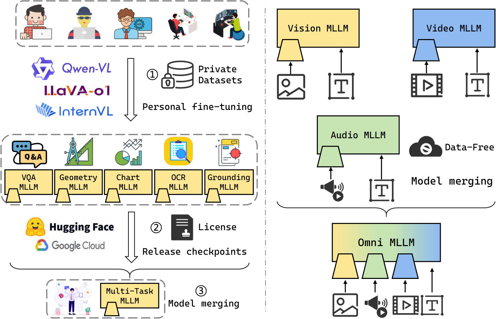

<div align="center">

# MLLMerging

**Official code for OptMerge (ICLR 2026) and the SWUDI / ASWUDI closed-form spectral merging family**

[](https://arxiv.org/abs/2505.19892)
[](https://openreview.net/forum?id=Me0n0iESJY)
[](https://huggingface.co/collections/yongxianwei/mllmerging-6833cd681869c47bd0b5200a)
[](./LICENSE)



</div>

## News

- **2026-05**: Added **SWUDI / ASWUDI** with reproduction pipelines for multimodal LLM, CLIP-ViT, Flan-T5 and Llama-3.2 merging ([details](#swudi--aswudi)).
- **2026-03**: The ICLR 2026 camera-ready of **OptMerge** is on [arXiv](https://arxiv.org/abs/2505.19892) and [OpenReview](https://openreview.net/forum?id=Me0n0iESJY).
- **2025-05**: Released the MLLM merging benchmark, code and [expert checkpoints](https://huggingface.co/collections/yongxianwei/mllmerging-6833cd681869c47bd0b5200a).

## OptMerge at a glance

Task-specific fine-tunes of MLLMs appear on Hugging Face much faster than new foundation models. OptMerge studies how to combine such experts into a single model **without any training data**.

- **Benchmark.** Five capability experts (VQA, Geometry, Chart, OCR, Grounding), each fine-tuned on at least 100K public samples, for both **LoRA** (Qwen2-VL-7B-Base) and **full fine-tuning** (InternVL2.5-1B-Instruct), evaluated on 10 benchmarks. A second track merges vision-, audio- and video-language models that share Vicuna-7B. All experts are [released](https://huggingface.co/collections/yongxianwei/mllmerging-6833cd681869c47bd0b5200a), and 10 merging algorithms are implemented on the benchmark.
- **Method.** OptMerge removes noise from task vectors with a low-rank approximation and stabilizes the data-free optimization of the merged vector. For LoRA experts it switches to SGD and starts from the mean task vector, so the merged vector does not inflate its norm, which would otherwise collapse language ability.
- **Findings.** The merged model comes close to or exceeds mixture-data training and the official instruct model, and merging modalities beats every single-modality model.

## Main results

Average over the 10 capability benchmarks (VizWiz, GQA, MathVista, MATH-Vision, ChartQA, TextVQA, OCRVQA, RefCOCO, RefCOCO+, RefCOCOg), from the paper ([arXiv v3](https://arxiv.org/abs/2505.19892v3)):

| Experts merged | Best other merging method | **OptMerge** | Reference |
|---|:---:|:---:|---|
| Qwen2-VL-7B, 5 LoRA experts | 61.88 (TIES + DARE) | **63.30** | 62.23 (Qwen2-VL-7B-Instruct) |
| InternVL2.5-1B, 5 full fine-tuning experts | 57.00 (WUDI) | **57.44** | 57.66 (mixture-data training) |
| Qwen2-VL-7B, 4 community checkpoints from Hugging Face | 66.58 (TIES + DARE) | **66.70** | 63.17 (best single checkpoint) |
| Qwen2.5-VL-32B-Instruct, 5 experts | not reported | **72.52** | 71.87 (best single expert) |

Merging the five InternVL2.5-1B experts takes 0.22 h and 2.62 GB of GPU memory, compared with 25.38 h and 240 GB for mixture-data training. In modality merging, the merged vision + audio + video model scores 67.00 on MUSIC-AVQA / AVQA, above the best single-modality model (64.11).

## SWUDI / ASWUDI

The current release extends OptMerge with **SWUDI**, a unified closed-form spectral solver for multi-task merging, and **ASWUDI**, its zero-hyperparameter adaptive variant. Method configs and full reproduction commands are in [`fusion_bench/README.md`](./fusion_bench/README.md).

| Line | Models | Code | Reproduction |
|---|---|---|---|
| **MLLM** | Qwen2-VL-7B, InternVL2.5-1B + 5 expert each | `LLaMA-Factory/swudi_aswudi.py`<br>`LLaMA-Factory/run_merge.py`<br>`LLaMA-Factory/run_merge_internvl.py` | [`fusion_bench/README.md`](./fusion_bench/README.md) §3.4 |
| **CLIP / Flan-T5 / Llama** | CLIP-ViT B/32, B/16, L/14 (TA8 / TALL20)<br>Flan-T5-base + 8 GLUE LoRA experts<br>Llama-3.2-3B + 5 MergeBench experts | `fusion_bench/fusion_bench/method/yongxianwei_merging/`<br>`fusion_bench/config/method/yongxianwei_merging/*.yaml` | [`fusion_bench/README.md`](./fusion_bench/README.md) §3.1 – §3.3 |

The two lines share the same SWUDI / ASWUDI math; the MLLM line keeps a
math-identical standalone copy at `LLaMA-Factory/swudi_aswudi.py` so MLLM
merging can run without installing the full `fusion_bench` package.

### Quick start

```bash
git clone https://github.com/WalkerWorldPeace/MLLMerging.git
cd MLLMerging

# A. CLIP / Flan-T5 / Llama line (Hydra-driven `fusion_bench` package)
cd fusion_bench && pip install -e . && cd ..

# B. MLLM line (Qwen2-VL / InternVL2.5)
cd LLaMA-Factory && pip install -e ".[torch,metrics]" --no-build-isolation && cd ..
cd VLMEvalKit    && pip install -e .                                       && cd ..
cd lmms-eval     && pip install -e .                                       && cd ..

# Smoke test
cd fusion_bench && python -m unittest discover -v -s tests -p "test_*.py" && cd ..
python LLaMA-Factory/sanity_red_minimal.py
```

> **Use separate conda environments for lines A and B**. See [`fusion_bench/README.md`](./fusion_bench/README.md) §1
> for the full four-environment matrix.

## Reproducing OptMerge (ICLR 2026)

### Checkpoints

You can find MLLM checkpoints at [🤗 Hugging Face collection](https://huggingface.co/collections/yongxianwei/mllmerging-6833cd681869c47bd0b5200a). The weights can also be automatically downloaded when running the model merging scripts below.

### QwenVL Merging

1. **Install the development version and dependencies:**
    ```bash
    cd LLaMA-Factory
    pip install -e ".[torch,metrics]" --no-build-isolation
    pip install qwen_vl_utils torchvision
    ```

2. **Select and modify the `merge_method` as needed, then run the merging script:**
    ```bash
    python model_merging.py
    ```

3. **To evaluate QwenVL on RefCOCO, RefCOCO+, and RefCOCOg:**

    - Prepare the evaluation environment:
        ```bash
        cd lmms-eval
        pip install -e .
        conda install openjdk=8
        ```
    - Download the datasets from Huggingface:
        - [RefCOCO](https://huggingface.co/datasets/lmms-lab/RefCOCO)
        - [RefCOCOplus](https://huggingface.co/datasets/lmms-lab/RefCOCOplus)
        - [RefCOCOg](https://huggingface.co/datasets/lmms-lab/RefCOCOg)
    - Run the evaluation:
        ```bash
        accelerate launch --num_processes=8 --main_process_port=12345 -m lmms_eval \
            --model qwen2_vl \
            --model_args=pretrained=merged_model_path,max_pixels=2359296 \
            --tasks refcoco_bbox_rec_val,refcoco+_bbox_rec_val,refcocog_bbox_rec_val \
            --batch_size 1 --log_samples --log_samples_suffix reproduce --output_path ./logs
        ```

---

### InternVL Merging

1. **Install dependencies:**
    ```bash
    cd InternVL
    pip install -r requirements.txt
    pip install timm
    ```

2. **Run the merging script:**
    ```bash
    cd internvl_chat
    python model_merging.py
    ```

3. **Prepare datasets for RefCOCO, RefCOCO+, and RefCOCOg:**
    ```bash
    # Create data directory and download annotation files
    mkdir -p data/refcoco && cd data/refcoco
    wget https://ofasys-wlcb.oss-cn-wulanchabu.aliyuncs.com/Qwen-VL/evaluation/refcoco/refcoco_val.jsonl
    wget https://ofasys-wlcb.oss-cn-wulanchabu.aliyuncs.com/Qwen-VL/evaluation/refcoco%2B/refcoco%2B_val.jsonl
    wget https://ofasys-wlcb.oss-cn-wulanchabu.aliyuncs.com/Qwen-VL/evaluation/refcocog/refcocog_val.jsonl
    
    # Download and unzip COCO images
    mkdir -p data/coco && cd data/coco
    wget http://images.cocodataset.org/zips/train2014.zip && unzip train2014.zip
    ```

4. **Run evaluation:**
    ```bash
    GPUS=8 bash evaluate.sh merged_model_path/ refcoco --dynamic
    ```

---

### Evaluating the Merged Model

1. **Install VLMEvalKit and configure evaluation:**
    ```bash
    cd VLMEvalKit
    pip install -e .
    ```
    - All VLMs are configured in `vlmeval/config.py`.  
    - Update the model path in `vlmeval/config.py` and select the model and evaluation datasets in `eval.sh`.

2. **Run evaluation:**
    ```bash
    bash eval.sh
    ```

3. **Summarize evaluation results:**

    To quickly summarize all evaluation results, you can run:
    ```bash
    python results.py outputs/merge_model_name
    ```

> **Note:** For reproducibility, use eager attention and load the model in float16.

---

### Modality Merging

1. **Install dependencies:**
    ```bash
    cd ModelCompose
    pip install -r requirements.txt
    ```

2. **Download required models and encoders:**
    - Pretrained LLM: [vicuna-7b-v1.5](https://huggingface.co/lmsys/vicuna-7b-v1.5)
    - Finetuned LoRAs for different modalities: [ModelCompose](https://huggingface.co/Adu2021/ModelCompose) (put in `checkpoints/`)
    - Encoders for different modalities:
        - `modelcompose/model/multimodal_encoder/beats`: [beats](https://huggingface.co/nsivaku/nithin_checkpoints)
        - `modelcompose/model/multimodal_encoder/clip-vit-large-patch14-336`: [clip-vit-large-patch14-336](https://huggingface.co/openai/clip-vit-large-patch14-336)
        - `modelcompose/model/multimodal_encoder/LanguageBind_Video_merge`: [LanguageBind_Video_merge](https://huggingface.co/LanguageBind/LanguageBind_Video_merge)

3. **Merge models:**
    ```bash
    python scripts/model_composition/merge_unimodal_modelcompose.py \
        checkpoints/multimodal-vicuna-7b-v1.5-video-naivemc \
        checkpoints/multimodal-vicuna-7b-v1.5-audio-naivemc \
        checkpoints/multimodal-vicuna-7b-v1.5-vision-naivemc \
        -o multimodal-checkpoint-name --strategy merge-ties
    ```
    - You can change the merging method with the `--strategy` argument.

4. **Evaluate the merged three-modality model:**

    - **AVQA:**
        ```bash
        bash scripts/model_composition/test/avqa.sh 0,1,2,3,4,5,6,7 multimodal-checkpoint-name video+image+audio checkpoints/vicuna-7b-v1.5
        ```
    - **MUSIC-AVQA:**
        ```bash
        bash scripts/model_composition/test/music_avqa_video+image+audio.sh 0,1,2,3,4,5,6,7 multimodal-checkpoint-name checkpoints/vicuna-7b-v1.5
        ```

---

## License

The code in this repository is released under the [Apache License 2.0](./LICENSE). Bundled third-party projects keep their own licenses: `LLaMA-Factory/`, `VLMEvalKit/`, `ModelCompose/` and `fusion_bench/` are Apache-2.0, while `InternVL/` and `lmms-eval/` are MIT. See the `LICENSE` file in each directory.

## Acknowledgement

This project thanks the following open source communities for their contributions:

- [FusionBench](https://github.com/tanganke/fusion_bench)
- [LLaMA-Factory](https://github.com/hiyouga/LLaMA-Factory)
- [InternVL](https://github.com/OpenGVLab/InternVL)
- [ModelCompose](https://github.com/THUNLP-MT/ModelCompose)
- [VLMEvalKit](https://github.com/open-compass/VLMEvalKit)
- [LMMs-Eval](https://github.com/EvolvingLMMs-Lab/lmms-eval)

Thanks to them for their contributions to the development of model training and evaluation tools!

## Citation
If you find OptMerge useful for your research and applications, please cite using this BibTeX:
```bibtex
@inproceedings{wei2025optmerge,
  title={OptMerge: Unifying Multimodal LLM Capabilities and Modalities via Model Merging},
  author={Wei, Yongxian and Cheng, Runxi and Jin, Weike and Yang, Enneng and Shen, Li and Hou, Lu and Du, Sinan and Yuan, Chun and Cao, Xiaochun and Tao, Dacheng},
  booktitle={The Fourteenth International Conference on Learning Representations},
  year={2026},
  url={https://openreview.net/forum?id=Me0n0iESJY}
}
```
